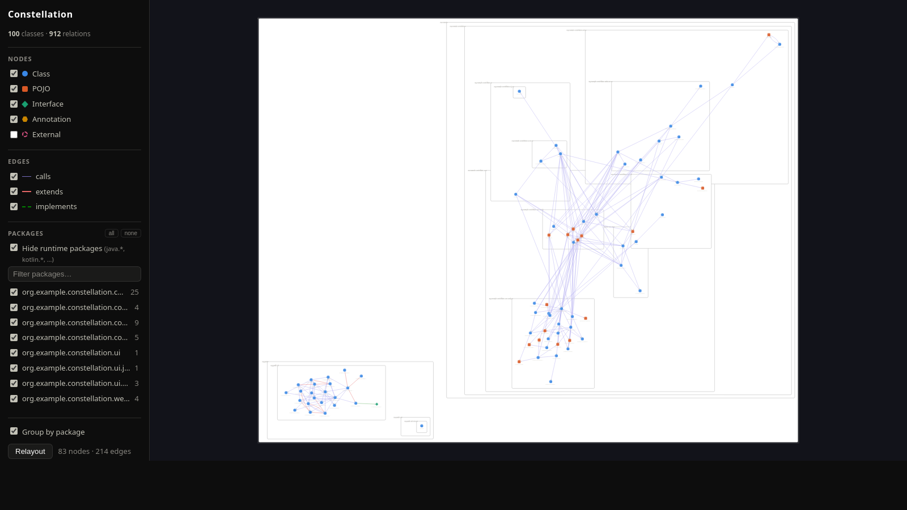

# Constellation

Инструмент для просмотра Java/Kotlin кода в виде графа-«созвездия»:
классы — вершины, связи между ними — рёбра.



Анализ работает по **скомпилированному байткоду** (ASM): один движок сразу для
Java и Kotlin, точные вызовы методов (класс + имя + сигнатура) и прямое
наследование, а классы внешних зависимостей определяются автоматически из ссылок.

## Быстрый старт (Gradle-плагин)

Инструмент применяется к проекту с исходниками через Gradle-плагин:

```kotlin
// build.gradle.kts целевого проекта
plugins {
    java // или kotlin("jvm")
    id("org.example.constellation")
}

// опционально:
constellation {
    port = 8080               // порт сервера
    openBrowser = true         // открыть браузер после старта
    includeTests = false       // добавить тестовые классы (категория Test)
    includeSubprojects = true  // из корня мульти-модульного проекта: классы всех подпроектов
}
```

```bash
./gradlew constellation
```

Задача сама зависит от компиляции и анализирует её результаты; в браузере —
панель фильтров слева, граф в центре, детали выбранной вершины справа.
`Relayout` — пересчитать раскладку; при смене фильтров позиции сохраняются.
Сервер слушает только `127.0.0.1`.

## Вершины и рёбра

| Категория вершины | Цвет / форма | Что это |
|---|---|---|
| Class | синий · круг | класс с поведением |
| Data model | оранжевый · скруглённый квадрат | носитель данных: java-bean, Kotlin data class, record, enum — фильтруется как шум |
| Interface | бирюзовый · ромб | интерфейс |
| Annotation | жёлтый · шестиугольник | `@interface` |
| External | розовый · пунктирный контур | класс из внешних зависимостей (по умолчанию выключен) |
| Test | зелёный · квадрат | класс из тестового source set'а (по умолчанию выключен) |

| Ребро | Цвет / стиль | Что значит |
|---|---|---|
| calls | фиолетовый · тонкая линия | класс вызывает методы другого класса (включая `new` и лямбды) |
| static calls | маджента · тонкий пунктир | вызовы статических методов (`invokestatic`, method references на static) |
| extends | красный · сплошная | прямое наследование (класс → класс, интерфейс → интерфейс) |
| implements | зелёный · пунктир | реализация интерфейса |

Клик по вершине — панель деталей: FQN, категория, модуль и source set,
исходный файл, методы с читаемыми сигнатурами, входящие/исходящие связи.

## Фильтры и группировка

Фильтрация собирается из предикатов ядра (`NodePredicates`/`EdgePredicates` +
`and`/`or`/`not`), UI только выбирает категории:

- **категории вершин** — Class, Data model, Interface, Annotation, External, Test;
- **трейты** — отдельные тумблеры для каждого трейта из каталога провайдеров
  (Static component, Data model — если не покрыт категорией, и любые будущие);
- **трейты методов** — скрытие вызовов по трейту (constructor, getter, setter);
  записи обрезаются внутри рёбер, опустевшие рёбра исчезают; у методов в панели
  деталей трейты показаны бейджами;
- **типы рёбер**;
- **пакеты** — выбор пакета включает и все его подпакеты;
- **скрытие runtime-пакетов** (`java.*`, `kotlin.*`, …) — включено по умолчанию;
- **группировка по пакетам** — вершины вложены в контейнеры-пакеты,
  подпакеты — в родительские (включена по умолчанию);
- **сворачивание пакетов** — клик по контейнеру сворачивает пакет в одну ноду
  `pkg (N)`, рёбра его классов агрегируются в общее ребро «depends»
  (клик по ноде разворачивает; вид можно пошарить через `?collapse=pkg1,pkg2`).

API: `GET /api/graph?kinds=CLASS,DATA&edges=CALLS&pkgs=com.foo&xpkgs=java.*&xcalltraits=GETTER`,
`GET /api/meta` — счётчики и каталоги трейтов (классов и методов).

## Архитектура

| Модуль | Ответственность |
|---|---|
| `modules/core` | **закрытая модель кода**, компонуемые предикаты, система трейтов с открытым реестром провайдеров, анализатор (ASM живёт только здесь). Публичный контур — единственный пакет `core.api` (с подпакетами `model`/`query`/`traits`/`traits.spi`); всё остальное — `internal`. Не знает про UI, HTTP и Gradle |
| `modules/webui` | встраиваемый HTTP-сервер (JDK `HttpServer`), JSON-API, веб-страница с cytoscape.js (вендорена, без CDN) |
| `modules/gradle-plugin` | Gradle-плагин `org.example.constellation`: задача `constellation`, зависит от компиляции, анализирует её результаты |

Ключевые решения:

- **Модель замкнута**: классы, виды, методы с читаемыми сигнатурами
  (`zip(String, int[]): int`), происхождение (`module` + source set или
  external). JVM-дескрипторы существуют только внутри анализатора.
- **Трейты — плагины**: встроенные `DataModel` (java bean / kotlin data class /
  record / enum) и `StaticComponent` (object-одиночка со статическим `INSTANCE`,
  static nested class, класс только со статическими членами — file facade,
  утилита); сторонние провайдеры регистрируются в `TraitRegistry` (кодом или
  через `META-INF/services/...ClassTraitProvider`) и автоматически попадают в
  JSON (`traits` у вершин, `traitCatalog` в meta) и в панель фильтров.
- `ProjectAnalyzer().analyze(AnalysisRequest(roots, registry))` — точка входа
  анализа; метки модулей передаются вызывающим (плагин знает их из Gradle).
- Классы вида `Foo$bar$1` (лямбды, анонимные объекты) не становятся вершинами,
  но их вызовы атрибутируются enclosing-классу через `EnclosingMethod`.

### Догфуд этого репозитория

```bash
./gradlew :webui:run --args="$PWD/modules/core/build/classes/kotlin/main $PWD/modules/webui/build/classes/kotlin/main"
```
(`DevMain` — внутренняя точка входа для разработки; поддерживаемый вход — плагин.)

## Разработка

```bash
./gradlew build                  # сборка + все тесты
./gradlew test -PskipPerfSmoke   # без перф-смока
```

Тесты (~103): анализатор на javac-фикстурах, трейты/реестр (включая
ServiceLoader), предикаты, JSON/API, смок сервера, ProjectBuilder + TestKit
для плагина, self-dogfood и perf-smoke.

## Ограничения

- Анализ по байткоду — целевой проект должен быть собран (плагин делает это сам).
- Владелец вызова — статический тип ресивера: вызов через интерфейс даёт ребро
  к интерфейсу, а не к реализации (как в IDE).
- Запуск на jar и «непонятно где» не поддерживается — только директории
  скомпилированных классов проекта.
- У внешних классов структурный вид неизвестен (они не анализируются) —
  аппроксимируются как Class.
